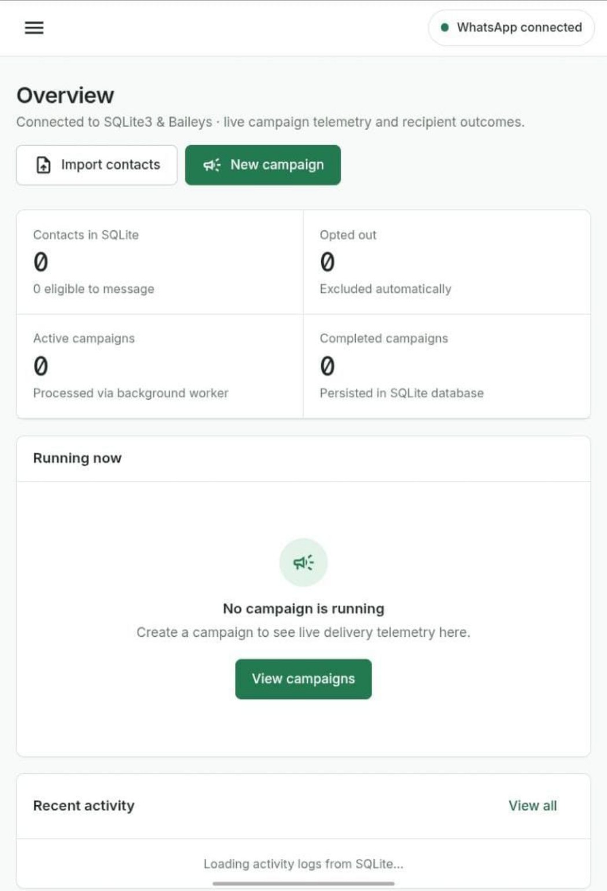
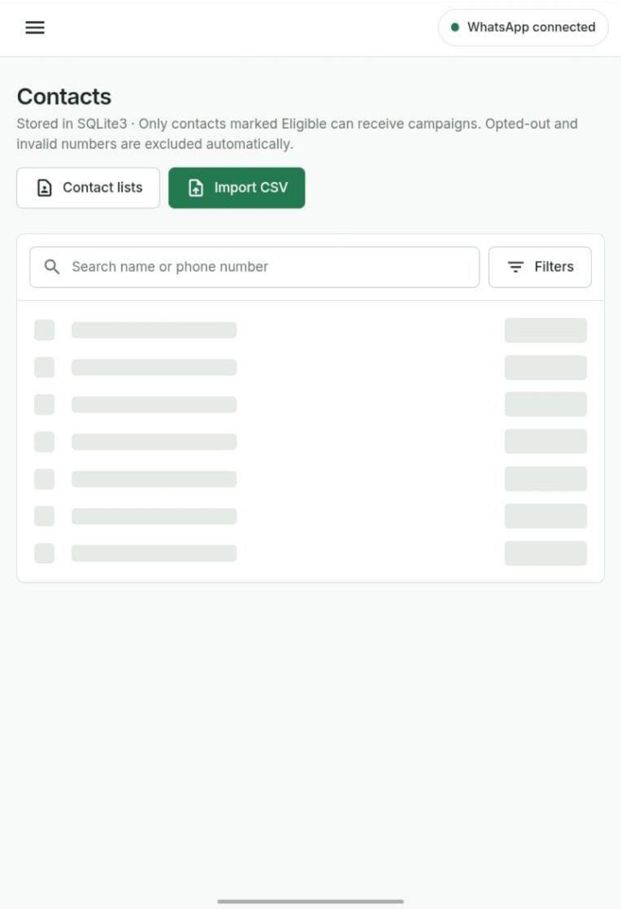
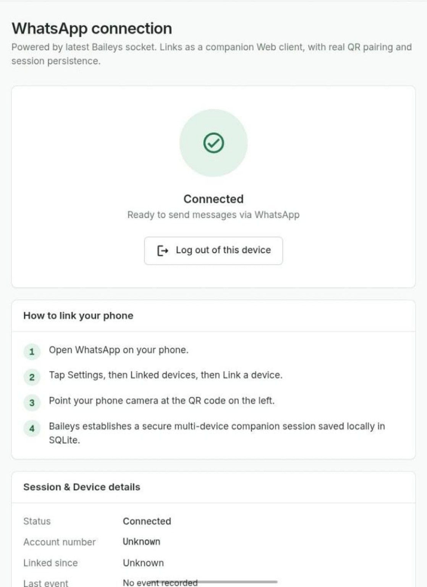
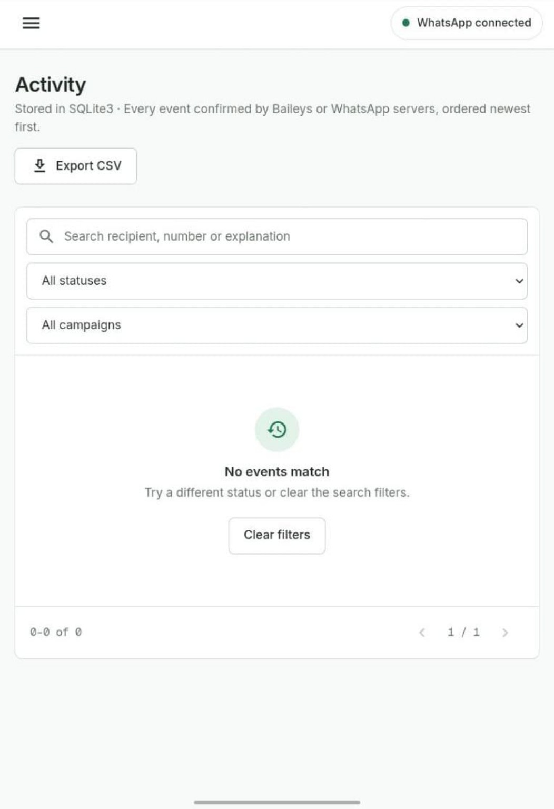
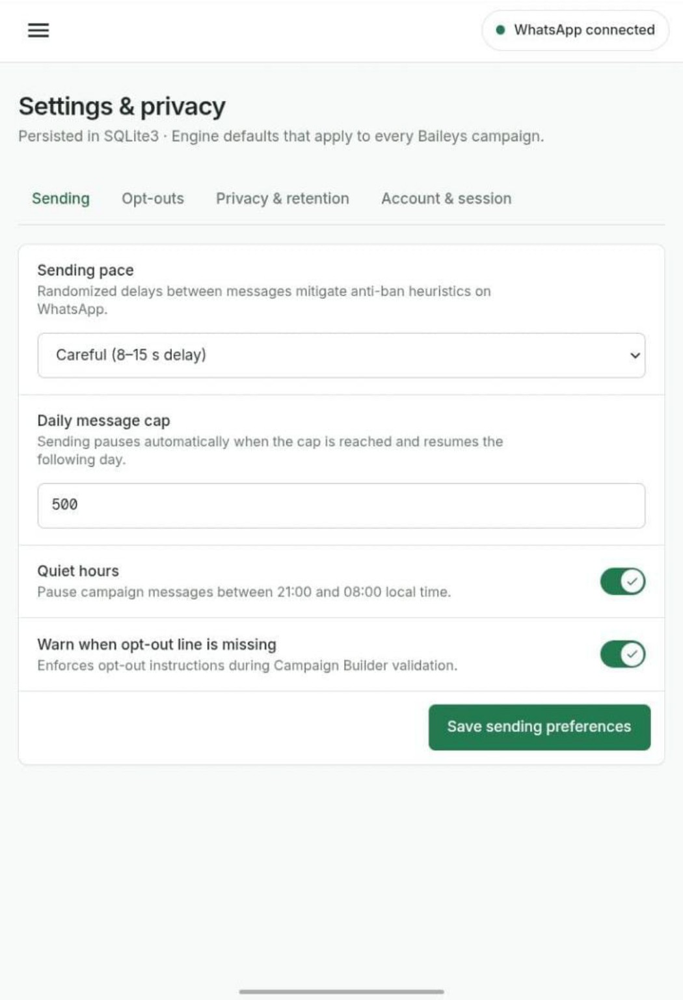
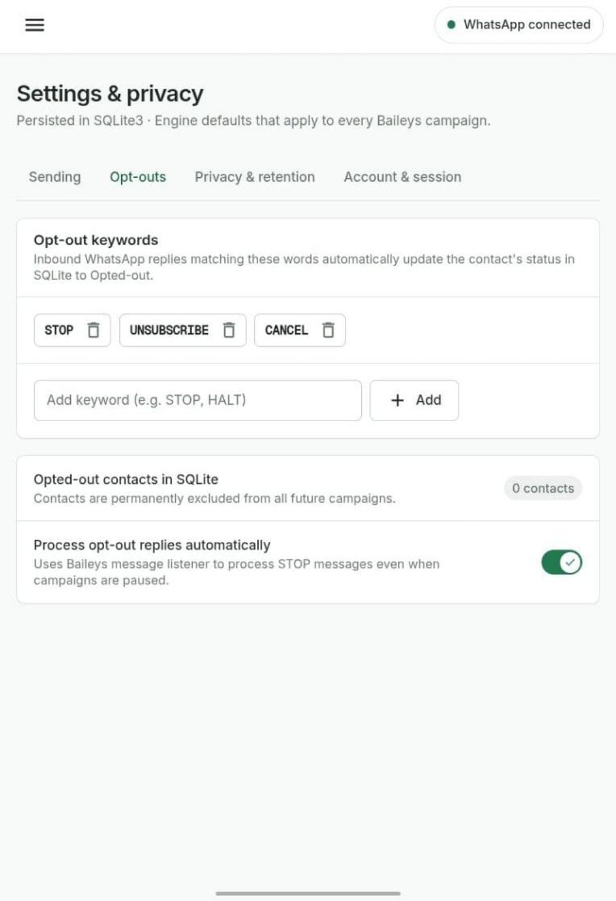
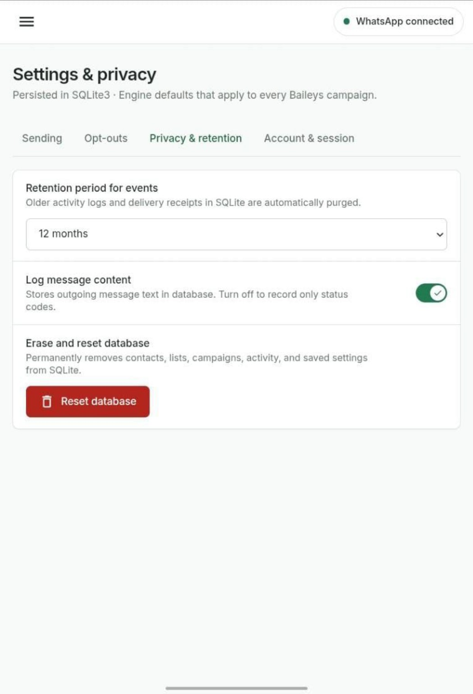
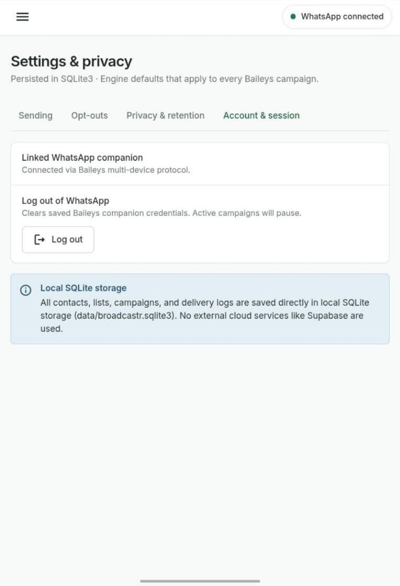

# ⚡ Power Zap

### Reach customers. Manage leads. Save time.

Power Zap helps business owners organize customer contacts and manage WhatsApp messaging from one place. It is designed for everyday business workflows—not just technical users.

> **Ready to simplify your customer communication?**
> Get started with Power Zap, organize your contacts, and create your first campaign.
> **Call to action:** [Get Started](#getting-started) · [Contact Us](#contact)

---

## What you can do with Power Zap

- **Organize contacts:** Keep customer and lead details in one place.
- **Import contact lists:** Bring in contacts using a CSV spreadsheet.
- **Create campaigns:** Prepare and manage messages for selected contacts.
- **Track activity:** Review campaign activity and recipient outcomes.
- **Manage opt-outs:** Exclude contacts who ask not to receive further messages.
- **Control sending preferences:** Configure campaign pacing, daily caps, and quiet hours.
- **Manage your connection:** View the linked WhatsApp session and log out when needed.
- **Keep data locally:** Contact, campaign, and activity data are stored in the app's local SQLite database, according to the current implementation shown in the interface.

## Sending safeguards and how they work

Power Zap includes controls to support considerate, consent-based messaging. These are operational safeguards—not anti-ban tricks—and they cannot prevent account restrictions or replace compliance with WhatsApp's terms and policies.

- **Message pacing:** Before each campaign message, the app estimates a wait from its content length: 40 ms per character, plus 60 ms per whitespace character and 100 ms per emoji code point. The wait is limited to 1–10 seconds.
- **Daily cap:** The app limits successful sends across all campaigns to 20 per day during the first week, 30 per day during the second week, and 45 per day from the third week onward. The week count begins with the first successful campaign send. When the daily cap is reached, queued campaign messages wait until sending is allowed again.
- **Quiet hours:** When enabled, campaign sends pause between 21:00 and 08:00 local time and resume after quiet hours.
- **Opt-out handling:** With automatic opt-out processing enabled, replies matching configured keywords (such as STOP, UNSUBSCRIBE, or CANCEL) mark the contact as opted out. Opted-out contacts are excluded from future campaign sends, including if they were already queued.
- **Opt-out instructions:** The optional Campaign Builder check warns or blocks validation when a message is missing opt-out instructions, according to the setting.

Only message people who have agreed to receive your communications. Honor every opt-out request, even if it does not match a configured keyword.

## Screenshots

### 1. Business dashboard

See contact totals, opt-outs, active campaigns, completed campaigns, and recent activity at a glance.

### 2. Contact management

Import contacts from a CSV file, search for people, filter records, and organize contact lists.

### 3. Connect WhatsApp

Link your WhatsApp account by scanning the QR code from WhatsApp's **Linked devices** menu. The screenshot shows a connected state.

### 4. Campaign activity

Review recorded activity and filter events by recipient, status, or campaign. Export activity to CSV when needed.

### 5. Sending preferences

Choose a sending pace, set a daily message cap, configure quiet hours, and enable a warning when campaign opt-out instructions are missing.

### 6. Opt-out management

Configure keywords such as STOP, UNSUBSCRIBE, and CANCEL. Contacts who opt out are excluded from future campaigns.

### 7. Privacy and data retention

Set how long activity events are retained and choose whether outgoing message content is logged. The database reset option permanently deletes stored app data.

### 8. Account and session settings

Review the linked WhatsApp companion session and log out when necessary. Logging out clears saved companion credentials and pauses active campaigns, as described in the interface.

## Getting started

1. Open Power Zap.
2. Connect WhatsApp using the in-app linking instructions.
3. Import a CSV contact list or organize your existing contacts.
4. Check contact eligibility and make sure recipients have agreed to receive your messages.
5. Create a campaign and review the message and recipient list before sending.
6. Monitor activity and honor opt-out requests.

## Who is Power Zap for?

- Small business owners
- Sales and marketing teams
- Real estate professionals
- Service providers
- Entrepreneurs and freelancers
- Teams managing customer enquiries and leads

## Responsible business messaging

Power Zap is intended for legitimate customer communication. Message only people who have given appropriate consent, honor opt-out requests, and follow WhatsApp's applicable terms and policies. Sending delays and daily caps are operational settings; they do not guarantee that an account will avoid restrictions.

## Contact

Want to use Power Zap for your business?

**Take the next step:** [Get Started](#getting-started) or contact the Power Zap team to ask about setup and usage.

- Website: www.safwanganz.tech
- Business WhatsApp: https://wa.me/917306771605
- Email: hello@safwanganz.tech

---

**Power Zap** — Less manual work. Better customer communication. More time for business.
